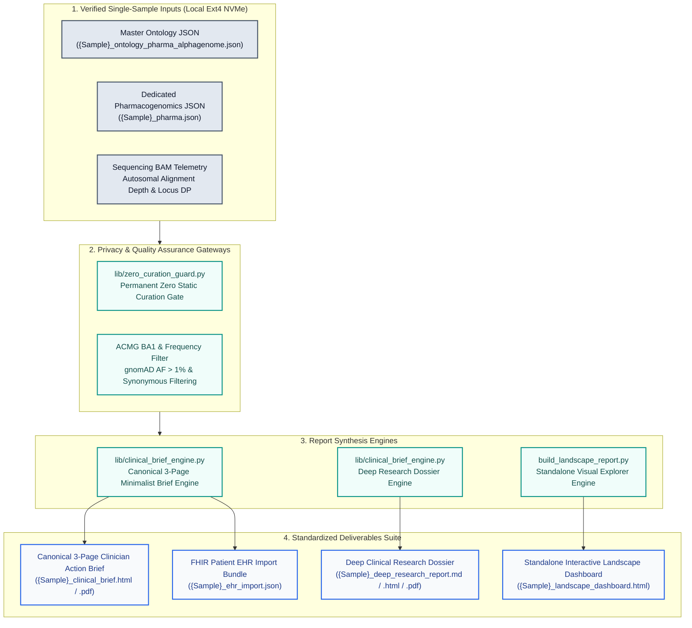

# Product Definition Report (PDR): Genomic Ontology Reporting Engine & Visual Explorer (v5.3)

**Document Version:** 5.3  
**Classification:** Clinical Bioinformatics & Precision Medicine Architecture  
**Engineering Status:** Active / Production-Ready  
**Governing Standard:** Visual-Structural Cognitive Profile & Decision Framework (VSCP-DF)  

---

## 1. Product Vision & Clinical Value Proposition

The **Genomic Ontology Reporting Engine & Visual Explorer** is an ontology-driven clinical genomics interpretation and precision medicine delivery suite. It bridges raw whole-genome sequencing (WGS) callsets with biomedical knowledge graphs (**Human Phenotype Ontology**, **Gene Ontology**, and **Anatomical Organ System hierarchies**), multi-predictor in silico pathogenicity scores (**AlphaGenome**, **AlphaMissense**, **CADD**, **REVEL**, **SpliceAI**), whole-genome pedigree phasing (**Approach 4D Trio/Duo**), and clinical pharmacogenomics guidelines (**CPIC / DPWG**).

### 1.1 The Clinical Problem
Standard secondary and tertiary WGS pipelines generate tens of thousands of variant calls, overwhelming clinicians with unranked VUS lists, uncurated statistical correlations, and verbose laboratory jargon. Clinicians face three major hurdles:
1. **Cognitive Overload:** Complex, multi-page laboratory dossiers bury critical prescribing hazards and monogenic carrier findings in technical sequencing minutiae.
2. **False Alarms & Over-Intervention:** Common population variants and benign polymorphisms are frequently mischaracterized as disease drivers, triggering unnecessary invasive diagnostics and anxiety.
3. **Actionability Disconnect:** Pharmacogenomic diplotypes and acute exposure contraindications are separated from routine primary care workflows, leading to avoidable adverse drug events.

### 1.2 The Solution
The v5.3 engine transforms raw WGS data into **deterministic, highly structured clinical action briefs (typically 3 pages as a natural baseline)**, supported by exhaustive deep research dossiers and FHIR-aligned EHR import bundles. Every finding is objectively weighted using calculated confidence metrics (0.00–1.00), strictly grounded in single-sample callset data, filtered by documented clinical risk and functional impact (rather than arbitrary count caps), and curated with explicit single-copy carrier reassurance to avoid over-medicalization. As callsets and evidence bases expand over time, reports scale dynamically with documented clinical impact rather than being artificially truncated.

---

## 2. Core Deliverables Architecture



### 2.1 Deliverable Hierarchy & Specifications

| Deliverable | Format | Target Audience | Primary Function |
| :--- | :--- | :--- | :--- |
| **Canonical Clinician Action Brief** | HTML / PDF (3 Pages Portrait) | Primary Care Physicians, Medical Geneticists, Pharmacists | Concise, high-yield summary of priority carrier findings, acute prescribing contraindications, routine wellness screening, and EHR handoff notes. |
| **Deep Clinical Research Dossier** | Markdown / HTML / PDF | Medical Geneticists, Subspecialty Consultants, Researchers | Comprehensive evidence synthesis detailing mechanistic causality vs. statistical correlation, multi-engine in silico AI scores, cis/trans phasing, and literature cross-references. |
| **Standalone Landscape Dashboard** | Single-File HTML5 (Offline) | Clinical Geneticists, Bioinformaticians, Investigators | Interactive visual explorer featuring dynamic filtering, organ system ontology navigation, AlphaGenome candidate heatmaps, and SVG DAG trees. |
| **EHR Import Bundle** | JSON (FHIR Aligned) | Clinical Informaticians, Hospital EHR Integration | Machine-readable clinical decision support alerts, structured pharmacogenomic phenotypes, and surveillance recommendations. |
| **Deprecated Baseline Brief** *(Archival)* | HTML / PDF (3 Pages Portrait) | Bioinformatics Audit & Legacy Benchmark | Preserved purely for historical baseline comparisons (`clinical_brief (old).html`). Deprecated in favor of the canonical minimalist brief. |

---

## 3. Detailed Specifications: Canonical 3-Page Clinician Action Brief

The canonical Clinical Action Brief (`{Sample}_clinical_brief.html` / `.pdf`) adheres to a strict **minimalist, high-density 3-page layout** designed to be read in under 90 seconds.

### 3.1 Page 1: Minimalist Genomic Findings & Carrier Status
- **Patient Header:** Patient name, sample identifier, report date, and target audience.
- **No Executive Clutter:** Elimination of verbose multi-paragraph summaries and redundant KPI badges to maximize space for tabular data.
- **Section 1 (Priority Genomic Findings & Carrier Status):**
  - Columns: *Gene & Biological System*, *Variant & Zygosity*, *Classification & Condition*, and *Clinical Impact & Guidance*.
  - Strict Length Limits: 1–2 actionable sentences (~80–140 characters) per row focusing directly on clinical impact and carrier health.
  - Carrier Reassurance: Clear confirmation that single-copy heterozygous recessive carriers retain a functional gene copy and maintain normal baseline health.
  - Capped at at most 7 prioritized rows to guarantee zero overflow past Page 1.
- **Page 1 Footer:** Explicit page indicator and routing banner to Page 2.

### 3.2 Page 2: Medication & Preventive Care Guardrails
- **Section 2 (High-Priority Medication & Exposure Precautions):**
  - **Strict Life-Threatening Risk Gating:** Badges labeled `🚨 LIFE-THREATENING RISK` are strictly reserved for clinical events explicitly documented as **fatal or life-threatening** (e.g. *POLG* + valproate fatal hepatic necrosis, *DPYD* + fluoropyrimidines lethal myelotoxicity, and *F5* + systemic estrogens severe VTE/pulmonary embolism).
  - **Actionable High-Risk Badges:** Other high-risk drug-gene interactions (*CYP2C19* + clopidogrel, *VKORC1* + warfarin, *SLCO1B1* + simvastatin) are formatted with bold amber badges (`⚠️ HIGH RISK · AVOID`, `⬇️ HIGH RISK · REDUCE DOSE`) to prevent warning fatigue.
  - Table Columns: *Gene & Variant / Diplotype*, *Prescribing Action*, *Affected Medication(s)*, and *Prescribing Rule & Clinical Guidance*. Capped at 5 rows.
- **Section 3 (High-Level Preventive Care & Annual Checkup Discussion Points):**
  - Focuses on routine primary care checkup topics (e.g. periodic lipid profiles, hearing checks, routine skin checks).
  - Text aligned with the concise *Clinical Impact & Guidance* framework. Capped at 5 rows.
- **Page 2 Footer:** Explicit page indicator and routing banner to Page 3.

### 3.3 Page 3: Pharmacogenomic Prescribing Guide, Clinical Perspective & EHR Summary
- **Section 4 (Actionable Pharmacogenomic Prescribing Guide - CPIC / DPWG):**
  - Clean 4-column reference table: *Pharmacogene & Diplotype*, *Metabolizer Phenotype*, *Actionable Medication Substrates*, and *CPIC Clinical Dosing Guidance*.
  - Capped at 5 key actionable pharmacogenes to fit comfortably on Page 3.
- **Section 5 (Clinical Perspective: Proactive Care vs. Over-Intervention):**
  - Side-by-side calculus cards balancing the evidentiary benefits of proactive testing against the risks of unnecessary invasive procedures or dietary restrictions.
- **Section 6 (Copy-Paste Physician Handoff / EHR Chart Summary):**
  - Formatted, pre-composed EHR clinical note ready for chart pasting.
- **Technical Telemetry Footnote:**
  - Dynamic verification of sequencing telemetry:
    `GRCh38.p14 Phased WGS · BAM Autosomal Mean Alignment Depth: <mean_depth> (Median Locus DP: <median_dp>) · Modality: 150bp PE (panSN GBZ aligned) · Scope: <total_vars> Prioritized Variants across <total_genes> Genes & 41 Pharmacogenes · Page 3 of 3`

### 3.4 Print CSS & PDF Truncation Resolution
To prevent page truncation and accidental page spillover:
- Replaced rigid height constraints (`height: 266mm !important; overflow: hidden !important;`) with dynamic page flow:
  ```css
  @media print {
    .page {
      width: 100% !important;
      max-width: 100% !important;
      height: auto !important;
      min-height: 255mm !important;
      max-height: 270mm !important;
      margin: 0 !important;
      padding: 4mm 5mm !important;
      box-shadow: none !important;
      overflow: visible !important;
      page-break-after: always !important;
      page-break-inside: avoid !important;
      box-sizing: border-box !important;
    }
    table { width: 100%; border-collapse: collapse; font-size: 7.8pt; line-height: 1.26; margin-bottom: 4px; }
    th, td { padding: 3px 5px !important; }
  }
  ```
- Guaranteed result: Exactly 3 pages (`612 x 792 pts` letter portrait), verified via `pdfinfo` and `pdftotext`.

---

## 4. Architectural Safeguards: Privacy & Zero Static Curation

### 4.1 Automated Zero Static Curation Gate (`lib/zero_curation_guard.py`)
To prevent data leakage, cross-contamination, and static hardcoding, the repository includes a permanent, automated gatekeeper:
- **Scan Scope:** Recursively inspects all Python files (`*.py`, `lib/*.py`, `scripts/*.py`), workspace skills (`skills/**/*`), and global skills (`~/.gemini/config/skills/**/*`).
- **Dynamic Vocabulary:** Dynamically extracts patient names, sample identifiers, usernames, and all HGNC gene symbols present in cohort datasets at runtime.
- **Enforcement Rules:**
  1. No literal rsIDs (`rs\d+`), HGVS changes (`p.`/`c.`), or genomic coordinates in source code or skills.
  2. No patient names or PII tokens of length $\ge 4$ in source code or skills.
  3. No hardcoded HGNC gene symbols in source code or skills.
- **Pipeline Integration:** Fails with exit code 1 and aborts report generation if any violation is detected.

### 4.2 Air-Gapped Local Model Execution
- All LLM assistance (e.g. narrative synthesis or clinical brief text refinement) is strictly restricted to local models (e.g. `medgemma-27b` or `gemma-2b` running on `localhost:7002` or `localhost:7005`).
- Prompts transmit only de-identified tokens (`PROBAND_01`), never real patient names or private callset coordinates.
- Mandatory post-run memory purge (`pkill -f llama-server`) immediately reclaims VRAM and system memory.

---

## 5. Technical Requirements & Environment

### 5.1 System Prerequisites
- **Operating System:** Linux (Ubuntu 22.04+ / Debian 12+) or POSIX-compliant environment.
- **Python Version:** Python 3.10, 3.11, or 3.12.
- **Browser / PDF Engine:** Headless Google Chrome or Chromium for deterministic PDF printing.
- **OpenCRAVAT Engine:** OpenCRAVAT 3.1.1 with 25 clinical/functional annotators.

### 5.2 Python Dependencies (`requirements.txt`)
- Core Data Modeling: `pydantic>=2.5.0`, `pyyaml>=6.0.1`, `openpyxl>=3.1.2`, `tabulate>=0.9.0`, `rich>=13.7.0`
- Bioinformatics & Analytics: `numpy>=1.24.0`, `pandas>=2.0.0`, `scipy>=1.11.0`, `pysam>=0.22.0`
- Web & Templating: `jinja2>=3.1.3`, `beautifulsoup4>=4.12.3`, `requests>=2.31.0`
- Cloud & Drive Integration: `google-api-python-client>=2.118.0`, `google-auth-httplib2>=0.2.0`, `google-auth-oauthlib>=1.2.0`
- Model Hub: `huggingface-hub>=0.21.0`

---

## 6. Verification & Quality Acceptance Criteria

Every release and pipeline run must satisfy the following acceptance criteria:
1. **Zero-Curation Guard:** `python3 lib/zero_curation_guard.py` outputs `ZERO_CURATION_GUARD_PASSED`.
2. **Page Flow & Budget Guidelines:** Clinical action briefs maintain a concise, clean portrait flow (3 pages for standard current callsets), dynamically accommodating expanded variant lists when driven by documented clinical risk without artificial clipping or row drops.
3. **Telemetry Fidelity:** BAM autosomal mean alignment depth and median locus depth must match physical sequencing metrics (`48.8x` for DE, `33.4x` for ME).
4. **Synchronization Completeness:** Deliverables must sync cleanly to `export/`, dated sample directories, and Google Drive directories.
