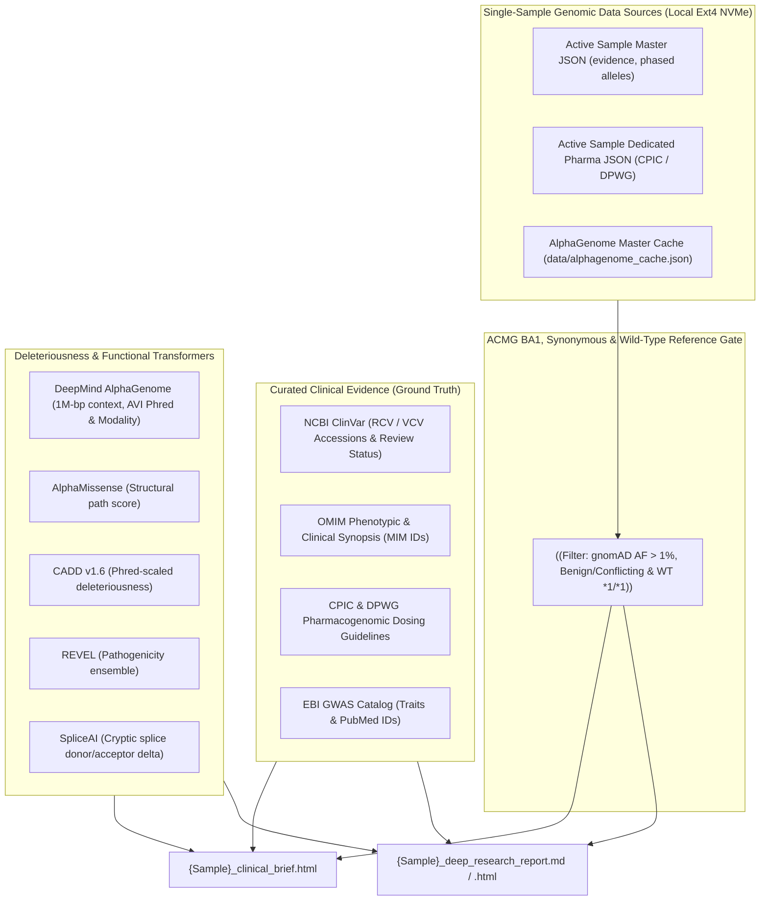

# Deep Genomic Research & Evidence Synthesis Skill

This skill governs the automated generation of concise, high-yield, 1-to-4 page Clinical Genomics Evidence Synthesis Reports and 3-Page Clinician Action Briefs for whole-genome sequencing (WGS) cohorts. It establishes an evidence reconciliation framework that cross-references monogenic disease databases with deep-learning biological foundation models to produce actionable clinical dossiers without factual extrapolation or cross-sample leakage.

---

## 1. Non-Negotiable Directives: Privacy, Local Isolation & Zero Fabrication

All agents and programs executing under this skill must adhere to the following strict boundaries:

1. **Air-Gapped Local Model Execution Only:**
   * Any AI model invocation must strictly target local inference engines running on `localhost` using **`medgemma-1.5-4b-it` (Multimodal with `mmproj-F32.gguf`)** or **`medgemma-27b`** (e.g. via llama-server router on `http://127.0.0.1:7002` or LM Studio on `http://127.0.0.1:1234`).
   * **Multimodal Engine Support:** `medgemma-1.5-4b-it` is the designated fast (~18-60 tokens/s), low-memory (~4GB) multimodal model equipped with medical vision projector (`mmproj-F32.gguf`) for joint analysis of clinical genomics, MRI/CT neuroimaging, echocardiograms, and genomic tracks. `medgemma-27b` serves as the high-parameter textual reasoning engine.
   * **Absolute Network Egress Prohibition:** No prompt containing sample identifiers, real names, or raw identifiable callsets may be transmitted to external cloud LLMs or remote internet endpoints.
2. **Local Model Lifecycle Management (Existence, Loading & Unloading):**
   * **Existence Check:** The runner checks for `medgemma-1.5-4b-it-Q8_0.gguf` + `mmproj-F32.gguf` and `medgemma-27b-text-it-Q4_K_M.gguf`.
   * **Load On-Demand:** The model is launched with Vulkan/AVX2 acceleration and up to 16,384 token context window.
   * **Mandatory Unload Post-Use:** Immediately after synthesis completion, the server process must be terminated to reclaim RAM/VRAM for high-throughput WGS bioinformatics pipelines.
3. **Strict Zero PII / PHI Transmission & Zero Specific Variant Hardcoding:**
   * **Zero Identity Knowledge:** External models, skills, and AI assistants must remain completely blind to real patient names, personal sample IDs, and specific private variant strings.
   * **Zero Specific Variant Information in Skills or Templates:** No skill file, prompt template, or reporting engine may hardcode sample-specific gene lists, variant coordinates, HGVS changes, or rsIDs. All variant selection and clinical mapping must derive 100% dynamically from the single active sample's input JSON callset and ontology metadata.
   * **Public Benchmark Testing Only:** All developer pipeline testing, prompt validation, and automated testing by AI assistants must strictly execute on public reference standards (e.g. **GIAB HG002 / HG003** in `/data/Genomes/HG002/`).
4. **ACMG BA1 Stand-Alone Benign & Synonymous Gating (Anti-False Reporting Guardrail):**
   * Any variant with population allele frequency $> 1.0\%$ in gnomAD (`gnomad4_af > 0.01`) or in silico consensus of neutrality ($\text{CADD} < 15.0$, $\text{REVEL} < 0.25$, AlphaMissense `likely_benign`) is **strictly disqualified from being elevated as a Primary Monogenic Finding or pathogenic driver**.
   * **Synonymous Variant Filter:** Silent synonymous variants (`so == "SYN"`) without severe splice alteration (`SpliceAI < 0.2`) are strictly gated from primary findings and pharmacogenomic contraindication dossiers.
   * **Wild-Type Reference Pharmacogene Filter:** Pharmacogenomic drug cards where the sample carries a wild-type reference diplotype (`*1/*1` or `reference/reference` with `Normal Metabolizer` status and no defining variant hits) must be excluded from actionable `AVOID` / `DOSE_DOWN` / `DOSE_UP` guardrails to prevent cross-sample or false-positive alerts.
   * Gene-level ClinGen "Definitive" assertions cannot elevate a variant whose ClinVar classification is `Conflicting` or `VUS`.
5. **Zero Invention / Zero Factual Extrapolation (Strict Grounding):**
   * The model and report generator are strictly prohibited from inventing, extrapolating, or hallucinating variants, gene associations, clinical recommendations, or pharmacological indications.
   * Every statement in the report must map directly to supplied data (exact ClinVar accession numbers `RCV`/`VCV`, OMIM morbid IDs, CPIC guidelines, or published PMIDs) from the active sample only.
6. **Mandatory Calculated Numerical Confidence Scores in Tables (0.00–1.00):**
   * Tables (Primary Findings, Non-Invasive Surveillance, and Clinical Decision Calculus) must include an explicit **Calculated Confidence** metric.
   * Confidence scores must be objectively calculated based on orthogonal evidence: ClinVar review stars, CPIC level, in silico deleteriousness consensus (CADD >= 20, REVEL >= 0.5, AlphaGenome AVI), and empirical WGS sequencing depth/allelic balance.
7. **Strict Grounding: Exact Single-Sample Callset Variant Match Across ALL Pipeline Models:**
   * **Universal Single-Sample Grounding:** Every gene symbol, HGVS notation (`c.` and `p.`), dbSNP rsID, and genomic coordinate referenced anywhere in model outputs, tables, dossiers, surveillance sections, narrative, and appendices must match the active sample's source JSON callset verbatim.
   * **Multi-Allelic Gene Disambiguation:** When a sample carries multiple distinct variants in the same gene, only the exact variant(s) present in that specific sample's callset may be tabulated or discussed, with their exact protein changes, rsIDs, and coordinates.
8. **Clean Slate Memory Purge & Pre-Execution Archival Directive (Zero Cross-Contamination):**
   * **Mandatory Memory & Cache Purge Prior to Run:** At the start of every synthesis run, all running local inference server instances must be forcefully terminated, KV-caches wiped clean, Python `__pycache__` / in-memory module caches cleared, and stale `/tmp/llama_server_*.log` files purged so that no residual context or prompt tokens linger between runs.
   * **Zero Retrospective Cross-Contamination:** The pipeline and report generation engines are strictly prohibited from ingesting, reading, or referencing prior synthesis runs, legacy HTML templates, draft files, or other samples' directories. Fresh synthesis must derive exclusively and cleanly from the verified primary `{sample}_ontology_pharma_alphagenome.json` and `{sample}_pharma.json` datasets of the single target sample.

---

## 2. Architectural Overview & Evidence Stack

The synthesis engine bridges primary single-sample callsets with curated scientific databases and deep neural transformer scores:



---

## 3. Universal Trait-Driven Evidence Triage (Zero Hardcoded Genes)

All variants are evaluated and prioritized using principled, domain-agnostic criteria based strictly on the active sample's own callset metadata:

### Category 1: Primary Monogenic & Clinically Actionable Findings
* **Inclusion Criteria:**
  1. ClinVar status `Pathogenic` or `Likely Pathogenic` without conflicting/uncertain submissions in a coding- or splice-altering variant with gnomAD $\text{AF} \le 0.02$.
  2. Curated ClinVar `Risk factor` or `Drug response` variants with established clinical actionability in the sample's callset.
  3. Disqualified: Variants with `Conflicting classifications of pathogenicity`, `Uncertain significance` (unless rescued by extreme multi-engine AI concordance without high AF), or silent synonymous calls (`SYN` with $\text{SpliceAI} < 0.20$).

### Category 2: Non-Invasive Blood Tests & Preventive Surveillance (Section 2.1)
* **Strict 1-to-1 Sample Isolation:** Every row in Section 2.1 must map 1-to-1 to a prioritized finding in the active sample's own Section 1.2 (plus a baseline hepatic/renal metabolic panel row tied to the active sample's own altered-metabolizer pharmacogenes).
* **Explicit Variant & Zygosity Display:** Every row in Table 2.1 must explicitly display the sample's triggering **Gene**, **HGVS Variant (`p.` / `c.`)**, **dbSNP `rsID`**, **Coordinate**, **Zygosity**, and **Read Depth (`DP`)**, paired with a concrete **Non-Invasive Venous Blood Test or Office Evaluation** routed to the **Primary Care Physician (PCP)** and relevant **Specialist Co-Consult**.
* **Heterozygous / Zygosity Non-Invasive Reassurance:** Every finding must explicitly state its zygosity and inheritance context and confirm that for heterozygous recessive carriers and pathway modifiers, **no invasive diagnostic procedures are warranted**.

### Category 3: Actionable Pharmacogenomic Prescribing Guardrails (Section 1.1 & Section 2.2)
* **Consistent Gene/Variant-First → Medication-Second Highlighting:** Every guardrail card in Section 1.1 must consistently highlight the **Gene, Diplotype/Variant, and Zygosity/Phenotype** in the card header, followed by the **Affected Medication(s) / Exposure** on line 1 of the body and the **Clinical Rule** on line 2.
* **Wild-Type Reference Filtering:** Exclude wild-type reference diplotypes (`*1/*1`, `reference/reference` with `Normal Metabolizer` phenotype and empty defining hits) from actionable `AVOID`, `DOSE_DOWN`, and `DOSE_UP` guardrails so only genuine non-wild-type pharmacogenomic findings from the active sample are reported.

---

## 4. Mandatory Deliverables & VSCP-DF Standards

The reporting suite produces synchronized clinical deliverables for a single isolated sample per invocation:

1. **Canonical 3-Page Clinician Action Brief (`{Sample}_clinical_brief.html` / `.pdf`):**
   * **Strictly 3 Pages Letter Portrait:** Print CSS enforces `height: auto !important; min-height: 255mm !important; max-height: 270mm !important; overflow: visible !important;` with compact cell padding (`3px 5px !important;`) and typography (`7.8pt !important;`), guaranteeing zero row truncation and zero spillover onto a 4th page.
   * **Page 1: Minimalist Genomic Findings & Carrier Status:** Patient header directly into **Section 1: Priority Genomic Findings & Carrier Status** with concise, high-yield *Clinical Impact & Guidance* (no executive summary narrative box or KPI strip clutter).
   * **Page 2: High-Priority Medication & Preventive Care Guardrails:**
     - **Section 2: High-Priority Medication & Exposure Precautions:** Restricts `🚨 LIFE-THREATENING RISK` strictly to risks explicitly documented as fatal or life-threatening (e.g. fatal hepatic necrosis, lethal myelotoxicity, or severe thromboembolism/PE). Other actionable high risks are styled with bold amber badges (`⚠️ HIGH RISK · AVOID`, `⬇️ HIGH RISK · REDUCE DOSE`).
     - **Section 3: High-Level Preventive Care & Annual Checkup Discussion Points:** Concise clinical impact & guidance paired with primary care wellness checkup topics.
   * **Page 3: Pharmacogenomic Guide, Perspective & EHR Summary:**
     - **Section 4: Actionable Pharmacogenomic Prescribing Guide (CPIC / DPWG):** Structured 4-column layout (`Pharmacogene & Diplotype`, `Metabolizer Phenotype`, `Actionable Medication Substrates`, `CPIC Clinical Dosing Guidance`) capped at 5 key actionable rows.
     - **Section 5: Clinical Perspective:** Side-by-side calculus cards balancing *Proactive Care Utility* against *Avoiding Over-Intervention*.
     - **Section 6: Copy-Paste Physician Handoff / EHR Chart Summary:** Preformatted clinical summary note.
     - **Technical Telemetry Footnote:** Full sequencing depth context (`GRCh38.p14 Phased WGS · BAM Autosomal Mean Alignment Depth: <depth> (Median Locus DP: <median>) · Modality: 150bp PE (panSN GBZ aligned)`).
   * *Deprecation Notice:* The older verbose baseline brief (`{Sample}_clinical_brief (old).html`) is deprecated in favor of this canonical minimalist brief.
2. **Deep Research Dossier (`{Sample}_deep_research_report.md` / `.html` / `.pdf`):**
   * Publication-grade research synthesis structured across VSCP-DF sections (`Orientation`, `Body`, `Conclusions`, `Opportunities`, `Confidence & Uncertainty Assessment`).
3. **Patient Self-Reported EHR Import JSON (`{Sample}_ehr_import.json`):**
   * Standards-compliant FHIR-aligned JSON bundle.
4. **Standalone Interactive Landscape Dashboard (`{Sample}_landscape_dashboard.html`):**
   * Offline, self-contained interactive visual explorer.

---

## 5. Automated Gatekeeper & Memory Purge Protocol

Before executing a synthesis run for any sample:
1. **Automated Zero Static Curation Guard:** Verify that all code and skills pass the automated gate:
```bash
python3 lib/zero_curation_guard.py
```
2. **Process & Memory Purge:** Purge running local inference servers (`pkill -f llama-server`), clear Python bytecode caches, and remove stale temporary logs.
3. **Execute Pipeline:** Run the standard reporting pipeline for a single sample at a time:
```bash
python3 run_standard_reporting.py <sample_key> --sample-dir <Sample_Dated_Folder>
```
